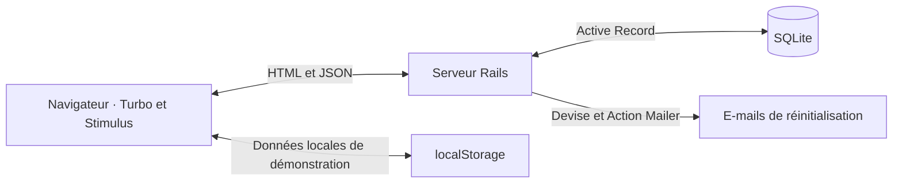

# Arrosage intelligent

Application web développée dans le cadre d’un projet de troisième année de BUT Informatique, autour du jardin d’un professeur.

Le professeur n’avait pas imposé de fonctionnalités précises pour l’application. L’équipe a donc proposé une interface pour organiser les zones du jardin, préparer les réglages d’arrosage et, à terme, suivre les capteurs et piloter l’arrosage.

Cette version correspond à la première soutenance. Le développement se poursuit jusqu’aux prochaines étapes du projet.

## Fonctionnalités disponibles

- **Comptes utilisateurs** : inscription, connexion, modification du profil et réinitialisation du mot de passe avec un lien valable 15 minutes.
- **Zones du jardin** : création, renommage, suppression et choix des cultures, avec des réglages propres à chaque utilisateur connecté.
- **Configuration de l’arrosage** : fréquence, créneaux horaires, dates de début et de fin, seuils de température, d’humidité et de luminosité.
- **Démonstration des capteurs** : attribution aux zones, états simulés et préréglages de seuils réutilisables.
- **Interface** : parcours de configuration par étapes, affichage adapté au mobile et paramètres de thème, de langue et d’unités.

Les zones et leurs réglages sont sauvegardés en base pour les utilisateurs connectés. Le mode démonstration est accessible sans compte ; ses données sont conservées dans le navigateur. Les associations de capteurs et la bibliothèque de préréglages restent également locales au navigateur, même après connexion.

## État du projet et travail restant

Le parcours de configuration fonctionne, mais l’application ne commande pas encore de matériel réel.

| Partie | État actuel et suite du développement |
| --- | --- |
| Capteurs | Mesures simulées, distinctes des seuils configurés. Connecter les capteurs réels pour afficher leurs mesures. |
| Arrosage | Réglages enregistrés. Relier les boutons « Démarrer » / « Arrêter » au matériel et exécuter la programmation. |
| Accueil et statistiques | L’accueil et l’historique par journée utilisent des données de démonstration. Les exports sont simulés. Relier ces pages aux mesures réelles. |
| Notifications | Options affichées dans les paramètres. Ajouter leur sauvegarde et l’envoi des alertes. |
| Administration des comptes | La page « Compte » utilise des utilisateurs fictifs, distincts des vrais inscrits. Prévoir une gestion des comptes réels avec les droits adaptés. |

Les prochaines étapes comprennent aussi l’harmonisation des unités et des traductions, les essais avec le jardin et la préparation du déploiement.

## Architecture du projet

L’application repose sur une architecture **MVC (Modèle, Vue, Contrôleur)** avec Ruby on Rails. Les pages sont rendues en HTML avec ERB ; Turbo gère la navigation et Stimulus les interactions dans le navigateur.



Pour un utilisateur connecté, une modification de zone est envoyée au contrôleur `GardenZonesController`. Celui-ci vérifie que la zone appartient à l’utilisateur, puis le modèle `Zone` valide les données avant leur enregistrement dans SQLite. La réponse JSON permet ensuite de mettre l’interface à jour.

Les deux modèles persistants sont `User` et `Zone` : un utilisateur possède plusieurs zones et chaque zone appartient à un seul utilisateur. `DemoStatistics` regroupe les données provisoires de l’historique, sans table en base. Les capteurs simulés et les préréglages sont actuellement gérés côté navigateur.

```text
app/
├── controllers/              # Requêtes, accès aux données et réponses
├── models/                   # Modèles Active Record et validations
├── views/                    # Pages ERB et éléments partagés (header, footer…)
├── javascript/controllers/   # Contrôleurs Stimulus : jardin, étapes, thèmes…
├── javascript/garden/        # Données des capteurs et horaires de démonstration
├── assets/                   # Feuilles de style et images
└── mailers/                  # Base des mailers de l’application
config/                       # Routes, environnements, traductions et Devise
db/                           # Migrations et schéma de la base
public/                       # Fichiers statiques, icônes et pages d’erreur
test/                         # Tests des modèles, contrôleurs et parcours navigateur
docs/                         # Documentation complémentaire, dont le guide SMTP
.github/workflows/            # Vérifications automatiques avec GitHub Actions
```

## Installation et lancement

Le projet utilise **Ruby on Rails 8.1**, **SQLite3**, **Hotwire (Turbo et Stimulus)** et **Devise** pour l’authentification.

Prérequis : Git, Ruby dans la version indiquée dans [`.ruby-version`](.ruby-version) (actuellement **4.0.6**), Bundler et SQLite3. Selon le système, des outils de compilation peuvent être nécessaires pour installer les gems.

```bash
git clone https://github.com/Gustin-MAILHE/Smart_Watering_Application.git
cd Smart_Watering_Application
bundle install
bin/rails db:prepare
bin/rails server
```

Ouvrir ensuite [http://localhost:3000](http://localhost:3000). Créer un compte depuis le formulaire d’inscription pour enregistrer ses propres zones, ou utiliser le jardin en mode démonstration.

La base de développement se trouve dans `storage/development.sqlite3`. Le JavaScript est chargé via Importmap ; aucune étape de compilation avec npm n’est nécessaire pour lancer l’application.

### Envoi des e-mails

En développement, sans configuration SMTP, les e-mails sont enregistrés dans `tmp/mail/` et ne sont pas envoyés dans une boîte de réception.

Pour activer l’envoi, suivre le [guide de configuration SMTP et de réinitialisation du mot de passe](docs/password-reset.md). La configuration de l’expéditeur se fait une fois pour l’application, puis le serveur doit être redémarré. Le fichier `config/smtp.local.yml` contenant les identifiants est ignoré par Git.

## Tests et vérifications

```bash
# Tests des modèles et des contrôleurs
bin/rails db:test:prepare test

# Tests des parcours dans un navigateur
bin/rails db:test:prepare test:system
```

Les tests navigateur utilisent Firefox avec Selenium et nécessitent Firefox ainsi qu’un pilote GeckoDriver compatible. Ils couvrent notamment la configuration du jardin, la séparation des données entre utilisateurs, les erreurs de sauvegarde, l’affichage mobile et la récupération du mot de passe.

Sur Ubuntu, l’installation Firefox via Snap est détectée automatiquement pour utiliser le véritable exécutable et son pilote, plutôt que le lanceur `/usr/bin/firefox`. Pour une installation personnalisée, les variables `FIREFOX_BIN` et `SE_GECKODRIVER` permettent de préciser leurs chemins.

Les tests, les contrôles de style Ruby et les analyses de sécurité sont également exécutés par GitHub Actions sur les pull requests.
